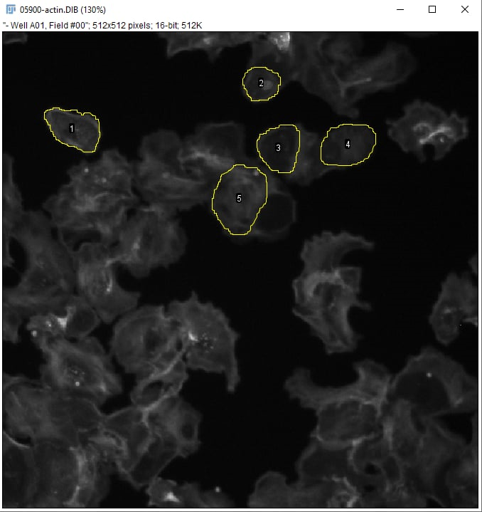
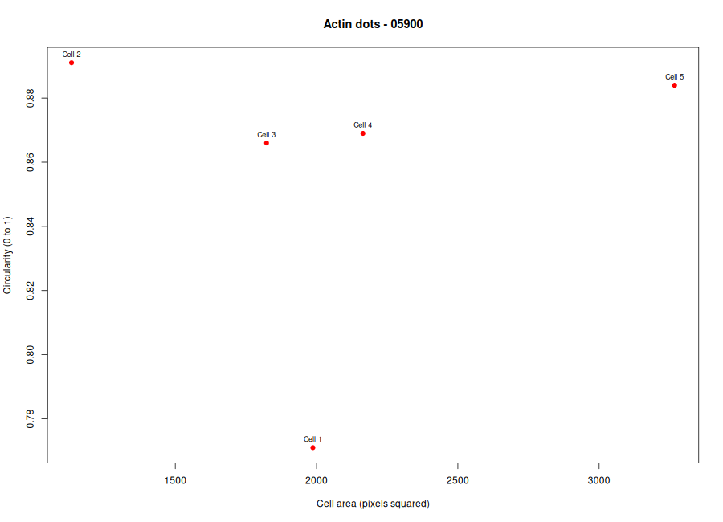
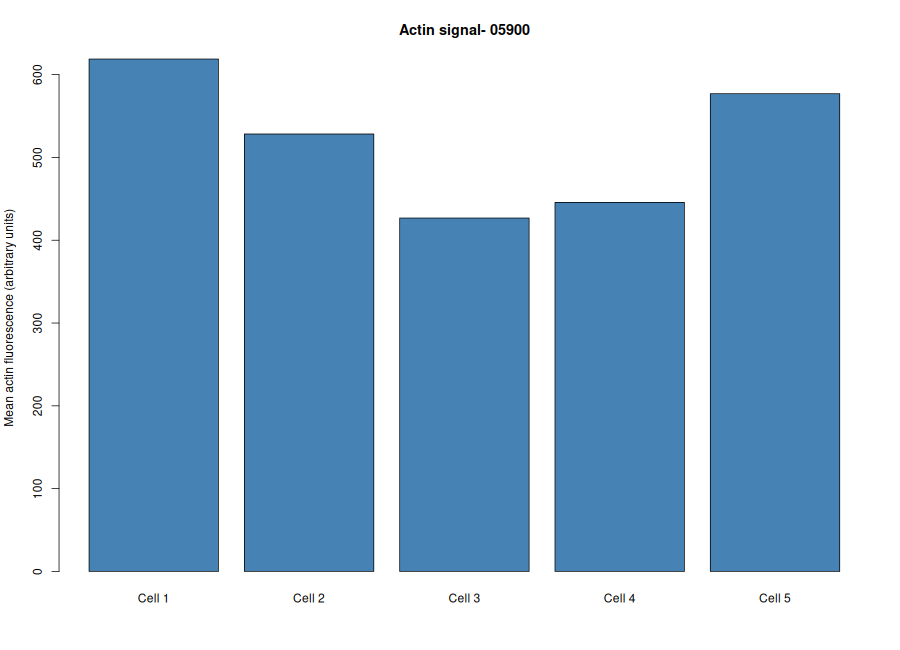

# Cytoskeleton and Cell Morphology

**Student ID:** 202400760

**Student Name:** Dave Lister F. Romano

**Chosen Phenotype:** Actin dots

**Actin Filename:** 05900-actin.DIB

**DNA Filename:** 05900-DNA.DIB

**Image Field ID:** 05900

**Dataset Download Link:** https://bbbc.broadinstitute.org/BBBC018

# Brief Fiji steps

### 1. Open the Images
1. Open Fiji and load `05900-actin.DIB` using **File > Open**.

2. Open the matching `05900-DNA.DIB` to help locate nuclei and distinguish neighboring cells.

3. Observe the actin staining and identify cells showing the **actin dot phenotype**.

### 2. Measure Five Cells

1. Go to **Analyze > Set Measurements** and select **Area**, **Mean gray value**, **Shape descriptors**, and **Display label**. Leave **Limit to threshold** unchecked.

2. Open **Analyze > Tools > ROI Manager**.

3. Use the **Freehand Selection** tool to trace five intact, clearly outlined cells on the actin image. Avoid overlapping cells and cells touching the image edges.

4. Press **T** to add each cell to ROI Manager, then press **M** to measure it.

5. Check that the Results table contains five rows with the columns `Area`, `Mean`, `Circ.`, and `AR`.

### 3. Save the Results

1. In the Results window, select **File > Save As** and save the measurements as `data/fiji_results.csv`.

3. In ROI Manager, select **Show All** and save a screenshot or annotated image as `figures/measured_cells.png`.

5. Keep the original DIB images unchanged.

### 4. Analyze the Data in R
Use the saved Fiji measurements to calculate the mean cell area, circularity, aspect ratio, and actin fluorescence intensity. Generate plots to summarize the measurements for image ID `05900`.

# Analysis Visualizations & Interpretations

### Micrograph Data

*Figure 1.* The image shows actin-stained cells under fluorescence microscopy, with five selected cells outlined in yellow for analysis of their shape, size, and fluorescence intensity.

### Cell Area vs. Circularity Scatter Plot

*Figure 2.* The scatter plot shows that the five cells have different sizes and circularity values. Cell 2 has the highest circularity, while Cell 1 has the lowest, suggesting that Cell 2 is more rounded and Cell 1 has a less regular shape.

### Mean Actin Fluorescence Intensity Bar Chart

*Figure 3.* The bar graph shows that Cell 1 has the highest actin fluorescence intensity, followed by Cells 5 and 2. Cells 3 and 4 have lower intensity values, indicating differences in the average actin fluorescence among the five measured cells.

# Four-Question Analysis

### 1. Which specific phenotype did you choose, and what visible features support that choice?
I chose the actin dots phenotype. This phenotype is characterized by dot-like spots in the actin fluorescence image, which should be visible as localized areas of staining rather than a uniform distribution. 

### 2. Were your five cells mostly round or elongated? Refer to your circularity and aspect-ratio results.
The five cells were generally round, with circularity values ranging from approximately 0.77 to 0.89. The aspect-ratio results should also be checked to confirm their shape, since values closer to 1 indicate rounder cells, while higher values suggest more elongated cells.

### 3. What role does actin play in maintaining cell shape and in cell movement (Karp Chapter 9)?
Actin filaments help maintain cell shape by supporting the cell cortex and providing structural strength. Actin polymerization and interactions with motor proteins also contribute to cell movement and changes in cell shape.

### 4. Why can a single fixed fluorescence image NOT show how fast a cell moves?
A fixed fluorescence image captures the cell at only one point in time, so it cannot show changes in position over time. Measuring cell speed requires live-cell imaging or time-lapse microscopy to track movement across multiple time points.

*Data credit: “We used image set BBBC018v1 from the Broad Bioimage Benchmark Collection (Ljosa et al., Nature Methods, 2012).” The images are licensed CC BY-NC-SA 3.0; retain attribution when sharing image-derived screenshots.*
